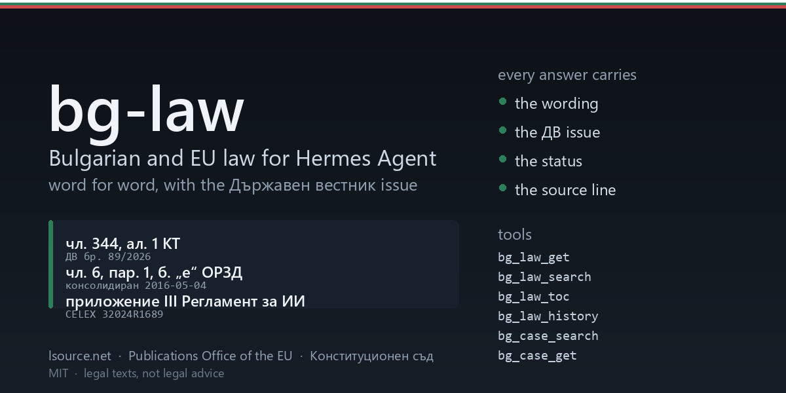

<div align="center">



</div>

# bg-law: Bulgarian and EU law for Hermes Agent

Ask Hermes for `чл. 344, ал. 1 КТ`, `чл. 6, ал. 1, б. „е“ ЗЗЛД` or `чл. 6, пар. 1, б. „е“ ОРЗД` and it
reads the provision from the source before it answers: the wording, the Държавен вестник issue that
produced it, the act's status, a link to the source page and a ready-made attribution line. It also
searches the Bulgarian act corpus, lists a law's articles, follows its amendment history issue by issue,
and reads acts of the Constitutional Court or a judgment of the Court of Justice of the EU.

- **Bulgarian legislation**: the consolidated text as reconstructed from Държавен вестник, 6,500+ acts
  and ordinances in force plus the repealed ones, each with its full promulgation chain
  (обн. and every изм./доп. with issue and date).
- **EU law**: regulations and directives from the Publications Office (CELLAR), in Bulgarian or English,
  consolidated version where one exists.
- **Case law**: acts of the Конституционен съд with their full text, and CJEU judgments by CELEX number,
  case number or name, read paragraph by paragraph.

Texts are cached locally, so repeated questions cost nothing and the cache survives a network outage.

## Install

```
hermes plugins install apoapostolov/hermes-bg-eu-law
```

Then set the API key, either in Settings, Plugins, bg-law (stored in `.env`, never in `config.yaml`) or
in the environment:

```
LSOURCE_API_KEY=sk_...
```

The key is free: register at [lsource.net/developers](https://lsource.net/developers) and create one. It
allows 60 requests a minute and 5,000 a day, which the plugin respects with one request per second and an
on-disk cache.

## The six tools

| Tool | What it does |
| --- | --- |
| `bg_law_get` | Read one article (and one алинея) of a Bulgarian act, or one article, recital or annex of an EU act |
| `bg_law_search` | Find a Bulgarian act by abbreviation or title word, plus the well-known EU acts |
| `bg_law_toc` | List an act's articles with the глава/раздел each sits in, optionally filtered by a word |
| `bg_law_history` | The full ДВ promulgation chain, the act's status, and the dates a point-in-time text exists for |
| `bg_case_search` | Find Constitutional Court acts by case number, act type, date or keyword |
| `bg_case_get` | Read one Constitutional Court act, or one CJEU judgment (one numbered point if asked) |

Citations are accepted the way people write them: `чл. 344, ал. 1, т. 3 КТ`, `§ 1 ЗЗД`,
`чл. 5 от Конституцията`, `чл. 6, ал. 1 от Закона за защита на личните данни`, `КТ чл. 344`,
`Art. 6(1)(f) GDPR`, `съображение 47 ОРЗД`, `приложение III Регламент за ИИ`. Latin letters typed for a
Cyrillic article suffix are understood (`чл. 2a` is `чл. 2а`).

## What a result looks like

```json
{
 "ok": true,
 "jurisdiction": "BG",
 "law": {"id": "kodeks-na-truda", "title": "Кодекс на труда", "abbreviation": "КТ"},
 "provision": {
  "citation": "чл. 344, ал. 1 КТ",
  "scope": "Глава шестнадесета. ПРЕКРАТЯВАНЕ НА ТРУДОВОТО ПРАВООТНОШЕНИЕ / Раздел IV. Защита срещу незаконно уволнение",
  "text": "(1) Работникът или служителят има право да оспорва законността на уволнението ..."
 },
 "version": {"status": "in_force", "issue": "ДВ бр. 89/2026", "changed": "2026-09-29",
             "official": false, "gazette_count": 129},
 "source": {"url": "https://lsource.net/laws/kodeks-na-truda", "license": "CC BY 4.0",
            "attribution": "Източник: Питай законите (lsource.net) ..."}
}
```

Every answer carries the attribution line and the version, because a Bulgarian statute without its ДВ
issue is not a citation, it is a guess with numbers.

## Where the texts come from, and why

| Source | What it serves | Why this one |
| --- | --- | --- |
| [lsource.net](https://lsource.net) | Consolidated Bulgarian acts, ДВ history, point-in-time text | The only free machine-readable source of consolidated Bulgarian legislation (CC BY 4.0). A free API key is required. |
| [Publications Office (CELLAR)](https://publications.europa.eu) | EU regulations and directives, CJEU judgments | Official EU publisher, structured ELI text in every language, no key needed. |
| [constcourt.bg](https://www.constcourt.bg) | Acts of the Constitutional Court | Official site, every act published in full, no key needed. |

Bulgaria has no official consolidated-legislation API. Държавен вестник publishes each issue, not a
consolidated act; parliament.bg carries adopted texts only; and lex.bg, the free consolidator most people
use, disallows automated clients in `robots.txt`. That is why the statute path asks for the free
lsource.net key instead of scraping a site that asked not to be scraped.

**Not covered**: the Supreme Courts (ВКС, ВАС), appellate and first-instance court practice (the ВСС
portal gates its search behind a CAPTCHA), municipal наредби, and the EU treaties (no ELI-structured
text for them at the Publications Office). The plugin says so instead of guessing.

## What it will not do

It returns legal texts, not legal advice. lsource.net reconstructs the consolidated text from the State
Gazette and labels it as not official, and the plugin repeats that in every answer: the version
promulgated in Държавен вестник and in the Official Journal of the EU binds. For a real case the user
needs a lawyer.

If a source cannot be reached, the answer comes from the cache and says so (`stale`). If a text is cut at
`max_chars`, the answer says so and names the way to get more.

## Settings

| Key | Default | Meaning |
| --- | --- | --- |
| `lsource_api_key` | empty | Free key from lsource.net/developers. Stored in `.env` as `LSOURCE_API_KEY`. |
| `language` | `auto` | Language of the attribution line: `auto`, `bg` or `en`. |
| `eu_language` | `bg` | Default language of EU texts. |
| `max_age_hours` | 24 | Cached acts older than this are revalidated with the source. `0` = always. |
| `cache_max_mb` | 200 | Oldest cached texts are dropped beyond this. |
| `case_law` | true | Allow `bg_case_search` and `bg_case_get`. |
| `eu_law` | true | Allow EU acts. |

## How this was checked

On 26.10.2026, on Windows 11 with Python 3.11, against the live sources: `чл. 344, ал. 1 КТ` (ДВ бр.
89/2026, 129 gazette entries), `чл. 2а КТ`, `чл. 12 КТ` (repealed, flagged), `чл. 5 от Конституцията`,
`чл. 115 НК`, `чл. 6, ал. 1 ЗЗЛД`, `чл. 9999 КТ` (`article_not_found`, no guess), `чл. 6, пар. 1, б. „е“
ОРЗД` and `Art. 6(1)(f) GDPR` (consolidated 2016-05-04), `съображение 47 ОРЗД`, `чл. 50 и приложение III
Регламент за ИИ`, `bg_case_search case_number=15/2026` (7 acts, ambiguous on read, then read by doc_id),
and `Schrems II` point 201. `python -m unittest discover -s tests` runs 50 offline tests over real
response fixtures with no network.

## License

MIT, see LICENSE. Derived in part from [hermes-de-law](https://github.com/MadeByBrain/hermes-de-law) by
MadeByBrain (MIT), which it credits for the HTTP, cache and CELLAR layers.
