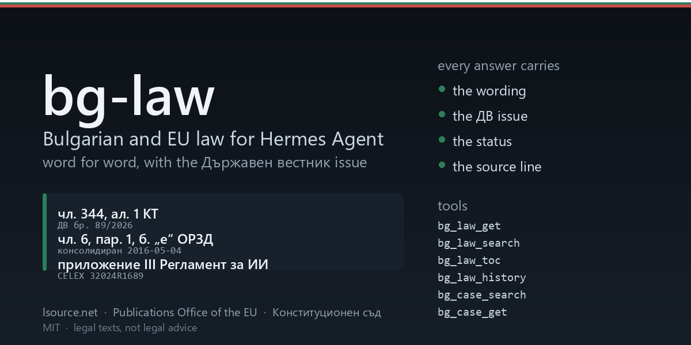

<div align="center">



</div>

# bg-law

A Hermes plugin for Bulgarian and EU law. It reads the provision before answering and returns the part
that makes the answer checkable: the Държавен вестник issue.

Ask for `чл. 344, ал. 1 КТ` and it comes back with the text of that алинея, the chapter and section it
sits under, the status of the act, the last amendment (ДВ бр. 89/2026 от 29.09.2026), a link to the
source page, and an attribution line ready to paste. A Bulgarian provision quoted without its issue
cannot be checked by anyone, and a model answering from memory will produce the number and the issue
with the same confidence. Removing that failure mode is the whole point.

The same rule runs through the other two jurisdictions. EU acts are read from the Publications Office in
Bulgarian or English, in the consolidated version where one exists, so `чл. 6, пар. 1, б. „е“ ОРЗД` and
`Art. 6(1)(f) GDPR` return the same provision in two languages. Case law is read, not summarised: an act
of the Конституционен съд can be read across consecutive pages, and a judgment of the Court of Justice
can be read one numbered point at a time, as in `Schrems II`, point 201.

Texts are cached on disk. Repeated lookups reuse the copy until its recheck interval expires. During
a source outage, the plugin can return a dated cached copy with a warning, or require a fresh check.

## Install

```
hermes plugins install apoapostolov/hermes-bg-eu-law
hermes plugins enable bg-law
```

Bulgarian statute text needs a free lsource.net key. Register at
[lsource.net/developers](https://lsource.net/developers), create a key, and paste it into
Settings, Plugins, bg-law. It is stored in `.env` as `LSOURCE_API_KEY` and never in `config.yaml`. The
default quota is 60 requests a minute and 5,000 a day. Requests are paced across processes sharing a
profile, and rate-limit errors preserve the source's retry guidance.

Press **Test connection** to check access to each source. The custom page is available while bg-law
is enabled; the generic Agent settings form remains available while the plugin is disabled.

Restart Hermes after an update, then start a new session to load the eleven tools. Existing keys and settings are
retained. The cache schema changes in 1.0.2, so legal responses are fetched and parsed again.

## What it accepts

Citations go in as people write them, not in a form invented by the schema: `чл. 344, ал. 1, т. 3 КТ`,
`§ 1 ЗЗД`, `чл. 5 от Конституцията`, `чл. 6, ал. 1 от Закона за защита на личните данни`, `КТ чл. 344`,
`Art. 6(1)(f) GDPR`, `съображение 47 ОРЗД`, `приложение III Регламент за ИИ`. A Latin letter typed for a
Cyrillic suffix is understood, so `чл. 2a` finds `чл. 2а`, and the definite article does not matter:
`Кодекса на труда` resolves to the same act as `Кодекс на труда`.

The 25 abbreviations Bulgarian lawyers actually write are resolved directly, among them КТ, НК, НПК,
ГПК, АПК, ЗЗД, ТЗ, СК, ЗН, ЗС, КСО, ЗДДС, ДОПК, ЗУТ, ЗЗЛД and ЗОП. Each row in that table was checked
against the live corpus, because a wrong abbreviation silently returns a plausible wrong act.

## Tools

| Tool | What it does |
| --- | --- |
| `bg_law_get` | A provision with validated paragraph, point or letter selection; dated BG text and explicit BG/EU revisions |
| `bg_law_search` | BG titles and abbreviations; `jurisdiction="EU"` searches CELLAR titles beyond the local aliases |
| `bg_law_toc` | The act's articles with the глава and раздел each sits in, filterable by a word, with a snippet |
| `bg_law_history` | The full ДВ promulgation chain and status of a Bulgarian act, or the consolidated versions of an EU act |
| `bg_case_search` | Constitutional Court filters and bounded keyword scans; `court="EU"` searches EU decision titles |
| `bg_case_get` | A Constitutional Court act or EU judgment, with continuation and numbered CJEU points |
| `bg_law_changes` | A diff between BG revision dates, or the change introduced by one revision hash |
| `bg_law_transposition` | BG/EU relationships with the sentences claiming implementation |
| `bg_law_recent` | Recent corpus amendments with their ДВ issues |
| `bg_law_export` | Paginated act text or Akoma Ntoso XML |
| `bg_law_status` | Redacted configuration, cache size and optional live source checks |

A result looks like this (trimmed):

```json
{
 "ok": true,
 "jurisdiction": "BG",
 "law": {"id": "kodeks-na-truda", "title": "Кодекс на труда", "abbreviation": "КТ"},
 "provision": {
  "citation": "чл. 344, ал. 1 КТ",
  "scope": "Глава шестнадесета. ПРЕКРАТЯВАНЕ НА ТРУДОВОТО ПРАВООТНОШЕНИЕ / Раздел IV. Защита срещу незаконно уволнение",
  "text": "(1) Работникът или служителят има право да оспорва законността на уволнението ..."
 },
 "version": {"status": "in_force", "issue": "ДВ бр. 89/2026", "changed": "2026-09-29",
             "official": false, "gazette_count": 129},
 "source": {"url": "https://lsource.net/laws/kodeks-na-truda", "license": "CC BY 4.0",
            "attribution": "Източник: Питай законите (lsource.net) ..."},
 "disclaimer": "Legal texts, not legal advice. The version promulgated in Държавен вестник, and the Official Journal for EU acts, is the binding one."
}
```

## Where the text comes from

Bulgaria has no official consolidated-legislation API, and the alternatives are worse than they look.
Държавен вестник publishes each issue, not a consolidated act, and its per-act page carries the title,
the issue, the section and the page number but no body text. parliament.bg serves a 4 KB
client-rendered shell for a law, with the text arriving from JavaScript. lex.bg, the free consolidator
most people use, answers with `User-agent: * Disallow: /`, so it is not touched.

That leaves [lsource.net](https://lsource.net), which reconstructs the consolidated text from the State
Gazette and publishes it under CC BY 4.0, with amendment history and dated text where the reconstruction
reaches back. The API includes repealed acts because historical queries need them. It
needs the free key, and it marks every record `official: false`, which the plugin repeats in every answer.

One consequence worth knowing before scraping it by hand: the public act page at `/laws/<id>` is a free
preview that stops mid-sentence. Кодекс на труда ends inside чл. 162. Only the API serves the whole act,
so the plugin reads the API and never the page.

An EU act's toc lists its recitals as well as its articles, because a recital is citable and the
consolidated text drops them; those rows come from the original Official Journal text and the answer says
so. `bg_law_history` on an EU act returns the consolidated versions the Publications Office publishes,
which is the only honest meaning of "history" for a regulation: they are real snapshots, unlike an
arbitrary as_of date.

EU law and judgments come from the Publications Office of the EU (CELLAR) through content negotiation:
XHTML in `bul` or `eng`, with the ELI structure intact (`art_6`, `rct_47`, `anx_III`, and `point201` for
a judgment), which is what makes article-level extraction possible at all. Constitutional Court acts come
from `constcourt.bg/search-acts`, a single document listing 951 published acts with their case numbers,
dates and reporting judges, plus a full-text page per act.

## What is not covered

The Supreme Courts and the lower courts. vks.bg is a JavaScript application with no discoverable
endpoint, and the ВСС portal that indexes all courts gates its search behind a CAPTCHA, so a scrape would
be both fragile and unwelcome. Municipal наредби sit on lsource's own site but not in its free API. The
EU treaties return no ELI-structured text from the Publications Office, so article-level extraction fails
on them.

Where a source is missing, the tool says so and links what exists. It does not fill the gap from memory.

## When something goes wrong

The plugin treats a missing answer as a result, not as an invitation. `чл. 9999 КТ` returns
`article_not_found` with the instruction to list the act's articles, never a neighbouring number. A
withheld text (HTTP 409, where the corpus audit flagged an act) comes back as `withheld` with the advice
not to quote it. A missing key returns `key_required` with the registration link, and a wrong key returns
`unauthorized` rather than a silent empty result.

The rest of the vocabulary is stable enough to branch on: `bad_argument` for input the tool cannot use,
`law_not_found` and `ambiguous_law` (with candidates), `article_not_found` and `paragraph_not_found`,
`case_not_found` and `ambiguous_case`, `as_of_not_available`, `host_not_allowed` for anything outside the
three source hosts, `disabled` when a feature is switched off in settings, and `internal` if the plugin
itself fails. Every error carries a `next_step` a model can act on.

`as_of` selects the revision **promulgated by** the requested date. It does not determine when each
provision took effect. Responses preserve the source's actual revision date in `as_of_used` and the
quoted revision's issue in `version.issue`; current whole-act status remains separate. Missing,
empty or newer historical text is refused. Repeated transitional section numbers are reported as
ambiguous rather than choosing the first one.

For an exact version, pass `revision` from `bg_law_history`: a BG revision hash or an EU consolidated
CELEX such as `02016R0679-20160504`. An unavailable EU snapshot never falls back to the original.
Recitals belong to the original publication and must be requested without a consolidated revision.

Long responses expose `next_offset`. Repeat the same provision, language and revision with that
offset to continue. Court decision pages use `parts.next_offset`, statute pages use
`provision.next_offset`, and exports use `document.next_offset`.

## Settings

The settings page groups connection checks, sources, languages, cache behavior and diagnostics.
Bulgarian legislation, EU legislation, the Constitutional Court and EU courts have separate switches.
The older combined `case_law` switch still works; saving source choices migrates it without enabling
sources that were previously off.

The recheck interval applies to every source, including EU snapshots and court indexes. `0` means
recheck every lookup. **Require a fresh source check** refuses expired copies during an outage;
**Allow cached copy with a warning** returns the copy with its check date. The default interval is
24 hours and the cache target is 200 MB. The response currently being read can exceed that target.

**Recheck on next lookup** expires cached responses without deleting their offline copies.
**Clear cache** removes downloaded legal responses. Diagnostics export includes settings, source checks
and cache totals; it excludes credentials, cached text and local paths. The local cache itself retains
request URLs, which can include search terms.

See [the tool and settings reference](docs/reference.md) for parameters, coverage and API behavior.

## Validation

```text
python -m unittest discover -s tests -v
python scripts/live_check.py
python scripts/audit_check.py
hermes plugins validate . --json
```

The offline suite has 90 tests, including six HTTP settings tests that require FastAPI and httpx.
Those six are skipped when the optional host packages are unavailable. The two live scripts require
`LSOURCE_API_KEY`; they use disposable caches and check the original workflows plus historical
identity, exact pinpoints, Tele2, snapshots, changes, transposition, export and EU title discovery.

The settings component was checked in a local preview using Hermes SDK controls and styles, including
connection feedback, invalid input, recovery and cache actions at desktop and narrow widths. The preview
uses sample connection state; HTTP tests cover the actual settings routes separately.

## Licence and limits

MIT, see LICENSE. The HTTP, cache and CELLAR layers derive from
[hermes-de-law](https://github.com/MadeByBrain/hermes-de-law) by MadeByBrain (MIT), credited in the
NOTICE file.

It returns legal texts, not legal advice. The State Gazette and the Official Journal bind, not this
plugin. For a real case the user needs a lawyer.
